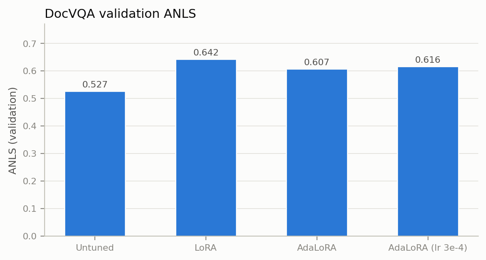
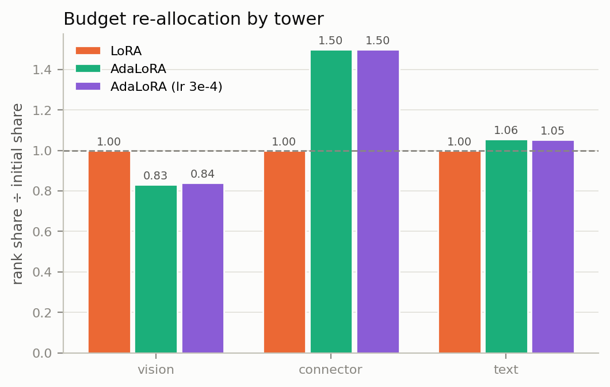
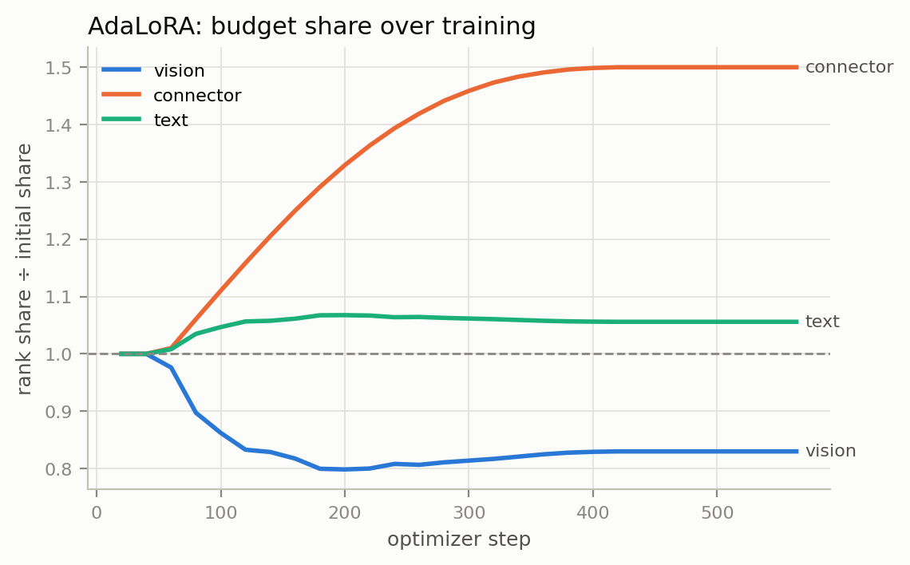
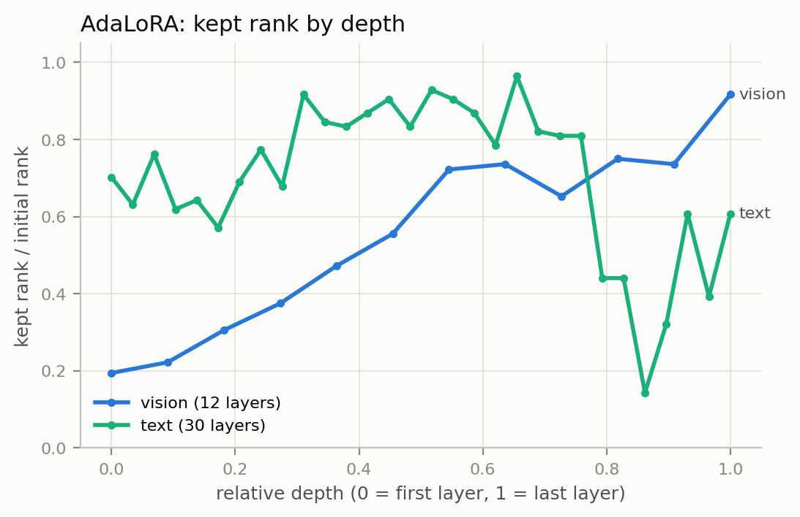
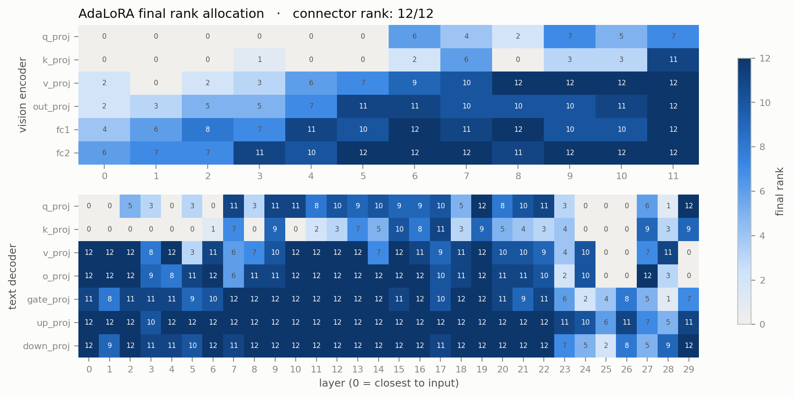
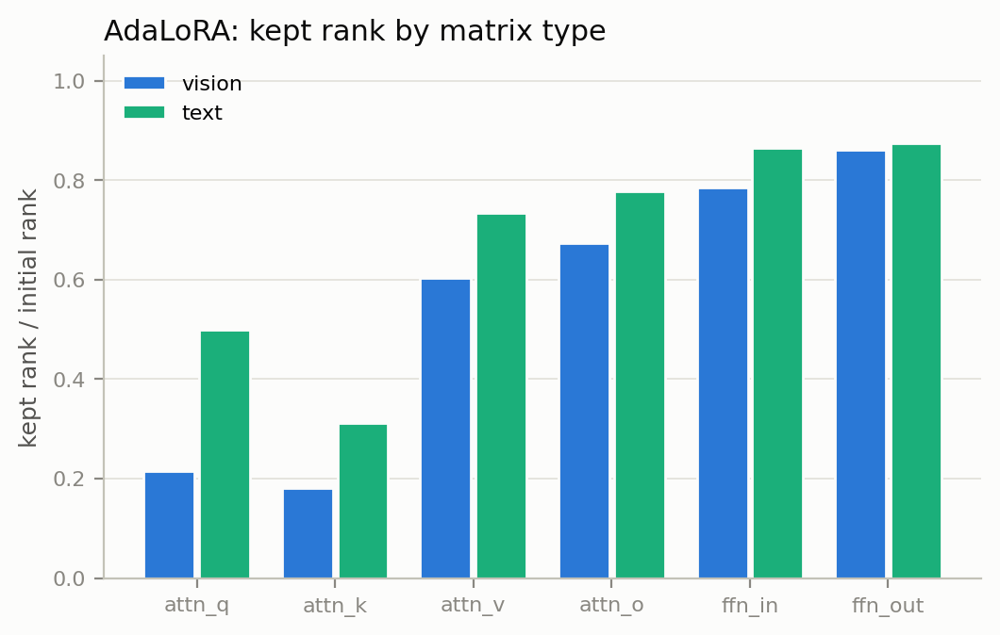

## AdaLoRA Finetuning for Vision Language Models

Standard Low Rank Adaptation (LoRA) allocates a fixed parameter budget (a uniform rank) across all model layers, wasting capacity on unimportant weight matrices while starving critical ones. The [AdaLoRA: Adaptive Budget Allocation for Parameter-Efficient Fine-Tuning](https://arxiv.org/abs/2303.10512) paper addresses this by treating the total trainable parameters as a flexible budget. AdaLoRA dynamically calculates gradient derived importance scores during training, automatically assigning higher ranks to crucial layers and pruning less important ones.

Although the original AdaLoRA method was evaluated on natural language tasks (and not vision language tasks), subsequent research has demonstrated the use of adaptive rank allocation in multimodal architectures. This project implements the AdaLoRA variant specifically for a Vision Language Model. The primary objective is to test whether the foundational conceptual claims of the paper still holds true when scaling the technique into vision domain.

### Methodology

The experiment finetunes `SmolVLM-256M-Instruct` on a 3,000 example `DocVQA` subset with LoRA and with AdaLoRA and then compares both against an untuned baseline on 500 validation examples, using `ANLS` (the standard DocVQA score). All settings are in [`configs/config.yaml`](configs/config.yaml). The main steps of the pipeline are:

1. **Builds the data subset (first run only):** `dataset/dataset.py` reads only the parquet footers of `HuggingFaceM4/DocumentVQA`, picks row groups at random using the seed and downloads just those rows. That gives `train_3000_seed42` and `validation_500_seed42`. Later runs reuse the saved subset, so all three methods see the same data.
2. **Loads the model:** SmolVLM-256M-Instruct is loaded in fp32.It has three parts: a 12 layer SigLIP vision encoder, a pixel shuffle connector, and a 30 layer SmolLM2 text decoder Adapters are added to **every linear layer in the vision encoder, the connector and the text decoder**(283 modules in total). The output head (`lm_head`) is left frozen.
3. **Training:** The run takes 564 optimizer steps: 1,500 batches ÷ 8 accumulation steps, rounded up, × 3 epochs.
4. **Evaluates:** Answers are generated greedily (at most 32 new tokens) and scored with ANLS using a 0.5 threshold.

### Implementation Details

- **Equal budgets:** LoRA uses rank `r=8` on every module, which gives 2,264 ranks in total. AdaLoRA starts at `init_r=12` (1.5× that budget) and is pruned down to an average of `target_r=8`, so both end with exactly 2,264 ranks.AdaLoRA reports more trainable parameters (5.8M vs 3.9M) because pruned singular values are masked to zero, not removed.
- **AdaLoRA schedule:** PEFT's cubic budget schedule.

  | Steps   | Phase                                               |
  | ------- | --------------------------------------------------- |
  | 0–55    | warm-up, no pruning                                 |
  | 56–451  | pruning; ranks re-allocated every `deltaT=10` steps |
  | 452–564 | allocation frozen                                   |

- `update_and_allocate(step)` runs after `optimizer.step()` and before `zero_grad()`, so AdaLoRA's importance scores are computed from the real accumulated gradients.

### Results

Untuned, LoRA and AdaLoRA use the shared config (`lr = 2e-4`). The AdaLoRA (lr 3e-4) row comes from a separate run that differs only in the learning rate. All rows use seed 42 and the same 500 validation questions.

The **allocation ratios** highlight how AdaLoRA shifts its parameter budget between the vision, text, and connector parts compared to a standard baseline `(Ratio = AdaLoRA Parameters / Standard LoRA Parameters)`.The **depth correlation ($\rho$)** indicates whether the model prefers putting those parameters in its later layers `(ρ > 0 means Deeper layers)` or its earlier layers `(ρ < 0 means Shallower layers)`.



| Method            | ANLS      | 95% CI      | Trainable params | Vision ratio | Connector ratio | Text ratio | Text / vision | ρ depth (vision) | ρ depth (text) |
| ----------------- | --------- | ----------- | ---------------- | ------------ | --------------- | ---------- | ------------- | ---------------- | -------------- |
| Untuned           | 0.527     | 0.486–0.568 | 0                | –            | –               | –          | –             | –                | –              |
| LoRA              | **0.642** | 0.601–0.682 | 3,872,256        | 1.00         | 1.00            | 1.00       | 1.00          | –                | –              |
| AdaLoRA           | 0.607     | 0.566–0.648 | 5,811,780        | 0.83         | 1.50            | 1.06       | 1.27          | 0.96             | -0.23          |
| AdaLoRA (lr 3e-4) | 0.616     | 0.574–0.657 | 5,811,780        | 0.84         | 1.50            | 1.05       | 1.25          | 0.96             | -0.18          |

Both finetuned models beat the untuned model. LoRA beats AdaLoRA by 3.5 points at lr 2e-4 and by 2.6 points at lr 3e-4.

### Reproduce

1. Create a seperate conda environment and install the dependencies.

```bash
git clone https://github.com/sasindipeiris/adalora-vlm.git
cd adalora-vlm
python -m venv .venv && source .venv/bin/activate
pip install -r requirements.txt
```

2. Run the 3 experiments using following commands:

```bash
python main.py --method zeroshot   # untuned baseline: evaluation only
python main.py --method lora       # experiment 1
python main.py --method adalora    # experiment 2
python main.py --compare           # generate detailed figures from all runs
```

Each run writes to `{output_root}/{method}_seed{seed}/`:

| File                                      | Contents                                                 |
| ----------------------------------------- | -------------------------------------------------------- |
| `results.json`                            | ANLS, parameter counts, timings, allocation summary      |
| `predictions.jsonl`                       | each validation prediction with its references and score |
| `config.json`, `train_config.json`        | the exact settings used                                  |
| `train_log.jsonl`                         | loss and learning rate every 10 steps                    |
| `adapter/`                                | final PEFT adapter                                       |
| `rank_allocation.json`                    | final rank of each module                                |
| `rank_history.jsonl`, `rank_modules.json` | AdaLoRA only: ranks every 20 steps                       |
| `checkpoint/state.pt`                     | resumable training state                                 |

#### Notes

- **Old runs are resumed, not restarted.** If `checkpoint/state.pt` already exists, training picks up from it, and after a finished run it skips straight to evaluation.
- **Running out of GPU memory.** Lower `train.batch_size` and raise `train.grad_accum` so their product stays 16. That keeps the total at 564 steps and the AdaLoRA schedule unchanged.
- **Precision depends on the GPU.** With `precision: auto`, a GPU that supports bf16 uses bf16 and a T4 uses fp16, so results can differ slightly between GPUs. Set `bf16` or `fp16` explicitly to match a specific run.
- **Changing the seed** produces a different data subset, a different shuffle order and new folder names (`*_seed{N}`). Run `--compare` for each seed.
- **Custom configs** must keep `train.alloc_log_every` a multiple of `adalora.deltaT`, or the trainer raises an error.

### Discussion & Conclusion

The core conceptual claim of the AdaLoRA paper is that importance aware budget allocation outperforms static rank assignment under constrained parameter budgets. In our VLM adaptation, we evaluated how the original paper's findings transferred to the multimodal domain:

| AdaLoRA paper claim                                            | Holds for this VLM?                                                                  |
| -------------------------------------------------------------- | ------------------------------------------------------------------------------------ |
| Importance scores give a structured and non-uniform allocation | ✅ **Yes**, and the allocation barely changes between learning rates (ρ = 0.95)      |
| Upper layers need more rank than lower ones                    | ✅ **Vision encoder** (ρ = 0.96)<br>❌ **Text decoder** (its last layers are pruned) |
| FFN and $W_o$/$W_v$ matter more than $W_q$/$W_k$               | ✅ **Both towers**, most sharply in the vision encoder                               |
| AdaLoRA beats LoRA at the same budget                          | ❌ **Not here:** 2.6–3.5 ANLS points behind                                          |

While AdaLoRA did not beat LoRA in overall accuracy, the dynamic allocation mechanism functioned exactly as intended revealing deeper insights into how the VLM prioritizes different components.

#### 1. Rank allocation by modality

<p align="center">
  
  
</p>

As training progressed, AdaLoRA shifted the parameter budget across towers. AdaLoRA finds that low level SigLIP features need almost no change for document analysis. Instead, it shifts the budget into the upper vision layers, the multimodal connector (reaching its maximum 1.50x initial share) and the middle of the language model.

#### 2. Rank allocation by depth

<p align="center">
  
  
</p>

The layer wise distribution confirms that not all layers are equally important, but reveals a clear architectural split:

- **Vision Encoder (Follows Paper):** Exhibits a strong positive correlation with depth (ρ = 0.96). Query/Key matrices in layers 0–5 are pruned almost to zero, while upper layer FFN, Value, and Output projections stay at or near full rank.
- **Text Decoder (Breaks Pattern):** Shows a negative correlation with depth. Most modules in layers 0–22 stay near full rank, while layers 23–29 are heavily pruned. This likely occurs because the text tower is an autoregressive _generative decoder_, whereas the original paper exclusively studied _encoder-only_ models.

#### 3. Matrix Type Preferences

<p align="center">
  
</p>

Within the modules, AdaLoRA consistently prioritized Feed-Forward Networks (`ffn_in`, `ffn_out`) and output/value projections over Attention query/key matrices (`attn_q`, `k`) across both towers, mirroring the original paper's findings. This pruning was most aggressive in the vision encoder.

#### 4. The Optimization Problem

The paper's accuracy claim does not hold in these runs this is an **optimization problem**, rather than a bad rank allocation. AdaLoRA loses the most ground on questions the untuned model could not answer at all (precisely the questions that require the most active learning) .

This is evidenced by AdaLoRA's training loss plateauing at ~0.20 (versus 0.06 for LoRA) and its weight updates being 7–15× smaller. Three causes are likely responsible for this bottleneck:

1. **Insufficient Steps:** `lora_E` starts at zero, and Adam moves each singular value by only about the learning rate per step. 564 total steps are simply not enough to build up large updates.
2. **Scaling Discrepancy:** AdaLoRA's updates are mathematically scaled down 1.5× relative to LoRA's.
3. **Missing Regularization:** The orthogonality regularizer designed to keep matrices A and B near orthonormal was never active during this run.

#### Conclusion

AdaLoRA successfully demonstrated its adaptive capabilities by identifying and shifting capacity to the connector, deeper vision layers, and FFNs. The logical structure of the rank allocation suggests that with an extended training schedule and corrected regularization, the method holds strong potential for multimodal architectures.

### Further Development

- Set `task_type="CAUSAL_LM"`, or call `model.base_model(**batch)`, so AdaLoRA's orthogonality regulariser is actually applied.
- Set AdaLoRA's `alpha=24`, so that `alpha / init_r` = 24/12 = 2 matches LoRA's 16/8.
- Tune AdaLoRA's learning rate (5e-4 to 2e-3) and run at least 3 seeds per method.
- Try smaller budgets (`target_r` = 2 or 4), where the paper reports AdaLoRA's largest gains.
- Raise `init_r` so the connector is not capped at its maximum rank.

### References

- **[AdaLoRA: Adaptive Budget Allocation for Parameter-Efficient Fine-Tuning](https://arxiv.org/abs/2303.10512)**

- **[SmolVLM: Redefining small and efficient multimodal models](https://arxiv.org/abs/2504.05299)**
